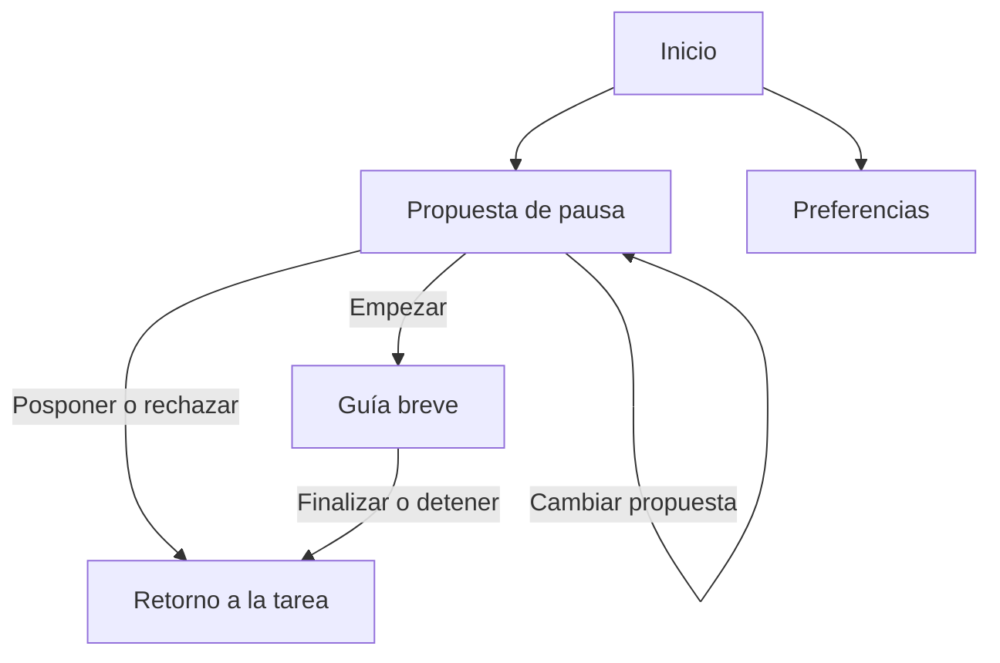

# Estética, estructura y accesibilidad de una app de pausas

**Auditoría 23-10:** ver [correcciones científicas y de producto](AUDITORIA_CIENTIFICA_MVP_2026-10-23.md). Apariencia cálida, control visible y contraste son decisiones/requisitos, no demostración de baja carga, ausencia de culpa, funcionamiento asistivo o eficacia conductual. La entrada desde una señal debe poder ir directamente a la propuesta sin recorrer Inicio. Computador/celular mantienen recorridos autónomos; todavía no hay accesibilidad o rendimiento comprobados de una app competitiva.

**Alcance confirmado por Alex:** mantener computador y celular para el contexto de estudio/trabajo con poco movimiento. Adaptar disposición y controles a cada pantalla conservando estados y lenguaje coherentes. No requerir cambio de dispositivo durante la pausa. Sistemas operativos y sincronización siguen por definir; esta decisión no selecciona framework.

**Continuidad de producto y pitch:** [síntesis del mecanismo conductual y MVP](INVESTIGACION_MECANISMO_CONDUCTUAL_MVP_Y_PITCH_2026-10-22.md). El acabado visual queda subordinado a una conducta, barrera y mecanismo explícitos; la nueva lectura de Baughan se limita al resumen en el sitio de la autora, no a un PDF completo.

**Precisión de la organización:** ver transcripción aportada por Alex [referencia del archivo de investigación, no incluida en este repo]. Investigación, ideas, material escrito y preparación técnica permitidos; código de la app solo después de la bienvenida, repositorio público sin desarrollo previo y sin reutilizar desarrollo de proyectos personales. Este registro precisa los resúmenes anteriores.

Fecha: 22-10-2026. Proyecto: nikucode. Estado: investigación selectiva y propuesta de diseño pendiente de evaluación; sin implementación del código a presentar.

## 1. Decisión provisional

Para la alternativa de app que Alex pide explorar, recomiendo **calidez visual, jerarquía familiar y una interacción breve**: fondo neutro, texto oscuro, acentos pastel, controles amplios con nombres claros y una acción principal por estado. La identidad tierna puede aparecer en ilustraciones pequeñas y textos; la navegación debe seguir siendo reconocible.

Esta propuesta combina evidencia sobre percepción visual, guías de accesibilidad y decisiones de diseño explícitas. No existe evidencia revisada que determine una paleta, cantidad de pestañas o distribución universalmente óptima para nikucode. La app sigue siendo una alternativa dentro del proyecto, sin cerrar las soluciones físicas u organizativas.

La aclaración oficial de Makana comunicada por Alex permite adelantar investigación y diseño; el repositorio y el código a presentar se reservan para el evento.

## 2. Alcance y método

Se recuperaron el informe local de estética/notificaciones y la ficha competitiva de Opal. Se contrastó el estudio móvil ya cubierto porque informa directamente esta decisión, sin repetir la investigación completa de pausas. Se añadieron fuentes sobre complejidad visual, tamaños táctiles, accesibilidad cognitiva y rendimiento, y se consultaron fuentes oficiales actuales de Opal, Wakeout, Finch y Stretchly.

Es una revisión dirigida, no sistemática: no hubo búsqueda exhaustiva ni evaluación formal completa del riesgo de sesgo. Las fuentes comerciales describen funciones y posicionamiento; no prueban sus efectos. En esta revisión no se hicieron nuevas ejecuciones ni auditorías de accesibilidad. La sesión de OpenCode aportada posteriormente sí documenta pruebas previas de Stretchly y Wakeout Chrome; sus límites se incorporan abajo. Opal sigue sin prueba de uso. Tampoco se realizó una inspección visual completa de sus pantallas actuales: las recomendaciones no dependen de atribuirles colores, tipografías o composiciones exactas no observadas.

### Evidencia local integrada desde la sesión completa de OpenCode

- **Stretchly:** en un ensayo personalizado sobre Hyprland/Wayland, Alex informó obstrucción de sus ventanas y escritura que no llegó al editor. No se determinó el mecanismo de foco o entrada ni se probaron todas las configuraciones. Añadir a la evaluación del diseño la continuidad de la tarea y la ausencia de obstrucción innecesaria. Resultado del ensayo [referencia del archivo de investigación, no incluida en este repo].
- **Wakeout Chrome 1.1.0:** un recorrido automatizado headless contabilizó una sesión y cuatro ejercicios sin entrada corporal; Snooze permitió regresar sin rutina. No es evaluación humana ni resultado de la app Apple con cámara. Identificar por separado temporizador/guía, autorreporte y movimiento observado. Los textos de juicio al posponer se observaron, pero no se midió su efecto emocional. Resultado del ensayo [referencia del archivo de investigación, no incluida en este repo].
- **OpalHelper:** el análisis estático rastreó construcción y compilación de AppleScript; no su ejecución ni el funcionamiento del bloqueo. No atribuir a esa inspección evidencia de usabilidad o accesibilidad. Análisis local [referencia del archivo de investigación, no incluida en este repo].

La sesión termina con investigación visual en curso: Baughan, Reinecke/Gajos, lectura individualizada y WCAG2ICT son pistas pendientes, no lecturas críticas completadas. Ver integración de la exportación completa [referencia del archivo de investigación, no incluida en este repo].

Las cifras en cuarentena de Leppe-Zamora no se usan. Pausa física, marcador de reanudación y jugabilidad conservan hipótesis independientes.

## 3. Qué aportan los papers

| Fuente y acceso | Hallazgo relevante | Límite y traducción al diseño |
|---|---|---|
| **Perrig et al. (2023)**, experimento móvil, N=281. Texto completo consultado, especialmente método, resultados y discusión. [Artículo](https://www.frontiersin.org/journals/psychology/articles/10.3389/fpsyg.2023.1113842/full). | Dos variantes de una app web funcional: mayor estética y usabilidad percibidas en la variante estética (d=1,26 y d=0,86). La comparación convencional no encontró diferencia significativa en tiempo (p=0,60) ni puntuación de desempeño (p=0,07). La evidencia objetiva es mixta. | Apoya cuidar el acabado visual; no demuestra más movimiento, retención ni una paleta concreta. Un resultado no significativo tampoco demuestra equivalencia. Evaluar agrado y éxito de tarea por separado. |
| **Tuch et al. (2012)**, dos experimentos con capturas web. Resumen primario consultado; no nueva lectura integral. [Registro de los autores en Google Research](https://research.google/pubs/the-role-of-visual-complexity-and-prototypicality-regarding-first-impression-of-websites-working-towards-understanding-aesthetic-judgments/). | Menor complejidad visual y mayor familiaridad estructural favorecieron la estética percibida en primeras impresiones. | Capturas y juicios rápidos, no uso prolongado ni accesibilidad. Fundamenta explorar orden y familiaridad; no obliga a eliminar toda ilustración ni predice eficacia conductual. |
| **Rosenholtz, Li y Nakano (2007)**, *Measuring visual clutter*. Resumen indexado consultado; apertura posterior no entregó el artículo. [DOI](https://doi.org/10.1167/7.2.17), [registro](https://pubmed.ncbi.nlm.nih.gov/18217832/). | Medidas de congestión visual se relacionan con desempeño de búsqueda en imágenes complejas. | Evidencia perceptiva indirecta para esta app; no entrega un número ideal de tarjetas. Sugiere reducir elementos que compiten por atención, conservando etiquetas y señales útiles. |
| **Parhi, Karlson y Bederson (2006)**, MobileHCI, N=20 diestros; PDF consultado, método y conclusiones. [PDF de Microsoft Research](https://www.microsoft.com/en-us/research/wp-content/uploads/2006/01/parhi-mobileHCI06.pdf?ref=scotthurff.com). | Estudió tamaño y posición de blancos táctiles con el pulgar en una PDA; recomienda aproximadamente 9,2 mm para tareas discretas y 9,6 mm para secuenciales. | Dispositivo antiguo, muestra pequeña y restringida; no representa todas las manos, discapacidades o teléfonos. Apoya controles generosos, no una «zona del pulgar» universal. Usar además guías actuales y pruebas reales. |
| **Metaanálisis 2026: *Attractive Things Do Work Better***. Resumen editorial recuperado por búsqueda; texto completo bloqueado con HTTP 403. [Editorial/DOI](https://doi.org/10.1080/10447318.2026.2664081). | El resumen informa 31 estudios, 234 efectos, N=18.794 y un efecto promedio g=0,29 en desempeño, con heterogeneidad alta. | Evidencia de actualización con revisión parcial: no audité extracción ni suplementos. Impide generalizar «la estética solo cambia percepción», pero tampoco selecciona estilo, layout ni colores. No usar como prueba de eficacia de nikucode. |

**Lectura conjunta:** la estética merece atención y puede relacionarse con desempeño, pero no sustituye la claridad operativa. «Minimalista», «pastel», «oscuro» y «redondeado» no son sinónimos de accesible. La cantidad de información debe responder a la tarea, no a una regla estética arbitraria.

## 4. Qué aprender de las otras apps

«Exitosa» requiere definir resultado: difusión, ingresos, valoraciones, retorno o beneficio. Aquí se analizan estrategias de productos conocidos; no se dispone de datos causales comparables que expliquen su éxito por la interfaz.

### Opal: estructura del producto y estrategias transferibles

La portada actual organiza su propuesta en Score, Rules, Timer y Gems. **Inferencia de diseño:** esa división comunica funciones con identidades reconocibles. Para nikucode puede inspirar separar acción, preferencias y consulta de información, sin reproducir el número de secciones. Las gemas hacen reconocible la marca; su presencia no demuestra que causen adherencia. [Portada oficial](https://opalapp.com/).

Su ayuda actual describe un **Opal Score** con dimensiones de sueño, foco y descanso, accesible desde Home → Score. Incluye estimaciones de uso, sueño, tiempo desconectado y porcentaje sentado. **Interpretación:** concentra información en un resumen y permite profundizar. Transferir la jerarquía resumen/detalle; no crear un «puntaje de salud» propio sin validar mediciones. La descripción no establece validez científica del índice. Esto actualiza la continuidad local que solo mencionaba Focus Score. [Ayuda actual del puntaje](https://help.opalapp.com/article/how-do-we-calculate-your-opal-score).

La documentación Mac describe reglas y niveles de compromiso, incluido un pase de emergencia semanal para sesiones estrictas. Es un mecanismo de restricción; no demuestra que obstaculizar la salida sea apropiado para pausas voluntarias. La información de Mac no se transfiere automáticamente a iOS o Android. [Ayuda Mac](https://help.opalapp.com/article/how-do-i-use-the-mac-app).

La ayuda de rachas y horas de foco presenta estas señales como recompensas. Para nikucode podrían convertirse en presión o administración; es una hipótesis de riesgo, no un daño medido aquí. No las incluiría en la primera comparación de layout. [Rachas y horas](https://help.opalapp.com/article/how-to-gain-streaks-and-focus-hours).

No hay en lo revisado un ensayo que aísle la estética o la distribución de Opal como causa de sus resultados comerciales o conductuales.

### Comparación enfocada

| Producto | Estrategia documentada | Qué explorar para nikucode | Qué queda sin demostrar |
|---|---|---|---|
| **Wakeout** | Su web destaca Move Now: un botón que elige un movimiento según preferencias, junto con guías, juegos y progreso. [Sitio oficial](https://wakeout.app/). | Una entrada directa a la acción y alternativas situacionales pueden evitar explorar un catálogo cada vez. Es una inferencia de diseño. | La ventaja causal del botón, de los juegos o de la selección automática. Sus afirmaciones de adaptación y accesibilidad no son una auditoría independiente. |
| **Finch** | Presenta autocuidado mediante el cuidado de una mascota. [Sitio oficial](https://finchcare.com/). | Una identidad afectiva puede ser una dirección de marca a comparar. | Que una mascota aumente pausas o deba estar en la pantalla principal. Tampoco inferir ausencia de culpa por el tono amable. |
| **Stretchly** | Vive en la bandeja y aparece periódicamente con propuestas de pausa; documenta aviso anticipado, posponer y omitir. [Documentación oficial](https://hovancik.net/stretchly/about/). | Una experiencia de pausas no necesita comenzar con un dashboard. Su aparición puede ser breve y contextual. | La frecuencia óptima, el movimiento realizado o un consumo bajo de recursos. Apariencia sencilla no equivale a ligereza técnica. |

**Propuesta derivada:** tomar la identidad reconocible y la jerarquía de información de Opal como referencias; la entrada directa de Wakeout; la posibilidad de calidez de Finch; y la presencia breve de Stretchly. Es una síntesis propia pendiente de prueba, no una combinación demostrada superior.

## 5. Requisitos de accesibilidad antes de elegir estilo

Las normas y guías no son ensayos de eficacia. Sirven para formular requisitos comprobables. WCAG es una referencia web; en una app nativa deben complementarse los criterios aplicables con guías y tecnologías de la plataforma. Cumplir contraste no certifica accesibilidad completa.

| Aspecto | Criterio propuesto | Fuente y condición |
|---|---|---|
| Contraste | Texto normal ≥4,5:1; texto grande ≥3:1. No expresar estados solo con color. | [WCAG 2.2, 1.4.3 y 1.4.1](https://www.w3.org/TR/WCAG22/). |
| Controles y estados | Información visual necesaria para reconocer controles/estados y gráficos significativos: contraste ≥3:1 frente a colores adyacentes, con las excepciones del criterio. | [WCAG 1.4.11](https://www.w3.org/WAI/WCAG22/Understanding/non-text-contrast). No exige bordes oscuros en toda tarjeta decorativa. |
| Tamaño táctil | Android: región interactiva ≥48×48 dp; iOS: referencia ≥44×44 pt. Separar blancos y evitar áreas superpuestas. | [Google, tamaño táctil](https://support.google.com/accessibility/android/answer/7101858?hl=en); [Flutter, comparación de guías por plataforma](https://docs.flutter.dev/ui/accessibility/ui-design-and-styling). dp, pt y CSS px no son unidades intercambiables. |
| Mínimo web | WCAG 2.2 AA 2.5.8 establece 24×24 CSS px con excepciones; no confundirlo con el objetivo ampliado de 44×44 de AAA. | [Norma WCAG 2.2](https://www.w3.org/TR/WCAG22/). Para este diseño conviene un objetivo táctil más generoso que el mínimo AA. |
| Texto ampliado | Respetar escala del sistema y evitar cortes al ampliar; probar al 200% y al máximo que ofrezca el destino. | [Google, escalado](https://support.google.com/accessibility/android/answer/12159181?hl=en). En móvil, permitir que filas se apilen y crezcan. |
| Comprensión | Jerarquía familiar, etiquetas explícitas y ubicación consistente. Un icono puede acompañar al texto. | [W3C COGA](https://www.w3.org/WAI/WCAG2/supplemental/objectives/o1-understandable/), orientación suplementaria, no requisito normativo adicional de AA. |
| Movimiento de interfaz | Respetar reducción de movimiento; poder prescindir de animación decorativa. Ninguna información depende solo de animación. | [WCAG 2.3.3](https://www.w3.org/WAI/WCAG21/Understanding/animation-from-interactions), nivel AAA; adoptarlo como objetivo propio, no atribuirlo a AA. |

**Criterios adicionales propios a verificar:** lectura con TalkBack/VoiceOver, orden lógico de foco, nombres/roles/estados anunciados, controles utilizables con teclado donde corresponda y foco visible. Evitar gestos ocultos obligatorios y arrastres sin alternativa. Texto alternativo para guías visuales; silencio posible sin perder información. No anunciar un temporizador cada segundo al lector de pantalla.

Si se incorpora movimiento corporal, ofrecer cambiar, detener o rechazar la propuesta. El detalle y la adecuación de cada movimiento requieren evaluación aparte; una interfaz accesible no acredita seguridad física de una rutina.

## 6. Dirección estética propuesta

**Elección de diseño, no prescripción científica:** una base limpia y cálida, con espacio entre grupos funcionales. Una tipografía de sistema, pesos regular y seminegrita, texto principal de partida alrededor de 16–18 unidades escalables según plataforma y prueba real. No usar tipografía diminuta para lograr que todo quepa. Evitar mayúsculas extensas y pesos muy finos.

Las ilustraciones pueden dar personalidad sin ocupar el lugar de una instrucción. Los kaomojis/ASCII son opcionales como decoración breve; no deben ser la única etiqueta ni producir lecturas repetitivas en tecnología asistiva. No trasladar automáticamente la exploración con secretos del sitio personal a una tarea que busca resolverse rápido.

### Paleta candidata y contraste calculado

| Uso | Par de colores | Contraste aproximado |
|---|---|---:|
| Texto principal / fondo cálido | `#202124` / `#FAF8F5` | 15,19:1 |
| Acento oscuro / fondo cálido | `#62567A` / `#FAF8F5` | 6,33:1 |
| Texto de botón / botón violeta | `#FFFFFF` / `#62567A` | 6,71:1 |
| Texto / superficie lavanda | `#202124` / `#EAE2F4` | 12,79:1 |
| Texto / superficie rosa | `#202124` / `#F4E1E7` | 12,86:1 |
| Texto / superficie verde | `#202124` / `#E0EEE5` | 13,44:1 |
| Texto / fondo oscuro alternativo | `#F4F1ED` / `#18191C` | 15,61:1 |

Cálculo local con la fórmula de luminancia relativa sRGB y `(Lmayor+0,05)/(Lmenor+0,05)`. Son valores de colores sólidos sin transparencia, redondeados para presentación. Solo se comprobaron estos pares. Deben revisarse también bordes, foco, iconos, estados y combinaciones finales; los fondos pastel por sí solos no garantizan distinguir botones del fondo.

Compararía dos variantes: **A, discreta**, con un acento; **B, cálida**, con superficies pastel y una ilustración pequeña. Misma disposición, textos, acciones y tamaños en ambas. La preferencia por colores no debe confundirse con una diferencia en comprensión o facilidad. Claro/oscuro puede seguir la preferencia del sistema; no se ha establecido aquí que uno sea universalmente mejor para la vista o el consumo.

## 7. Estructura y disposición candidatas

Esto es un esquema de información para evaluar la alternativa de app; no una arquitectura de software elegida.

| Estado o área | Contenido prioritario | Acciones y ubicación |
|---|---|---|
| **Inicio** | Estado comprensible de las pausas y entrada directa a una propuesta. | Acción principal visible; acceso explícito a preferencias. No exigir revisar estadísticas ni crear cuenta para una prueba local si no hace falta. |
| **Propuesta de pausa** | Qué se propone, duración orientativa y posibilidad de adaptarla. | Empezar, cambiar propuesta, posponer y rechazar con nombres claros. La cantidad y el texto exactos se prueban. |
| **Guía** | Una instrucción o secuencia breve; imagen solo si ayuda a entender. | Detener y volver disponibles; evitar navegación secundaria durante la acción. No requerir mirar continuamente el teléfono. |
| **Cierre** | Final de la guía, sin asumir que terminó el movimiento corporal. | Volver a la tarea. Si se necesita saber qué ocurrió, autorreporte opcional claramente identificado. |
| **Preferencias** | Avisos, horarios si corresponde, sonido, texto y movimiento visual. | Controles agrupados por propósito; detalles avanzados bajo demanda. |
| **Historial opcional** | Datos que de verdad se hayan observado o declarado. | Separado del recorrido principal; evitar convertir temporizadores terminados en «pausas realizadas». |

Una vista inicial con acceso a preferencias podría bastar; añadir navegación persistente solo si existen destinos frecuentes que la justifiquen. «Tres pestañas» o «un solo clic» no son mandatos científicos. Priorizar legibilidad aunque haga falta desplazarse al ampliar texto.

El marcador de reanudación se evaluaría con/sin marcador manteniendo lo demás constante. El juego se evaluaría con/sin capa lúdica sobre el mismo movimiento y guía. Ninguno entra como requisito de la primera prueba estética.

## 8. Qué significa que sea ligera

**Ligereza cognitiva:** reconocer qué está pasando y qué se puede hacer, sin recordar pasos ni descifrar iconos. **Ligereza de interacción:** pocas decisiones pertinentes, opciones de salida accesibles y ninguna espera decorativa obligatoria. **Ligereza técnica:** tiempos, memoria, CPU, batería, red y tamaño medidos en el destino. No se deduce del aspecto visual.

Como decisiones de ingeniería a evaluar: recursos locales pequeños, fuente de sistema, guía textual siempre disponible, ilustraciones estáticas y carga diferida del contenido opcional. Evitar vídeo continuo, cámara, sondeo frecuente o servicios externos si no resuelven una necesidad demostrada. No se elige framework por estas recomendaciones.

Si se elige web, RAIL ayuda a separar respuesta, animación, inactividad y carga. Usarlo como marco de medición web, no como certificación ni como umbral universal de batería o memoria. [Google, RAIL](https://web.dev/articles/rail).

Durante la implementación habrá que registrar dispositivo, sistema, tipo de build y condiciones; comparar arranque frío/caliente, fluidez, uso en reposo y coste de avisos. Elegir presupuestos de rendimiento antes de medir y ajustados al hardware real; no inventar ahora un límite universal de MB o batería.

## 9. Prueba mínima para decidir

1. **Fijar primero la tarea y el layout:** localizar la pausa, cambiar una propuesta inviable, posponer, rechazar, detener una guía y desactivar avisos. El mismo escenario ficticio para todas las variantes.
2. **Revisión de accesibilidad:** contraste, escala de texto, etiquetas, orden de foco y reducción de movimiento. En un prototipo visual se puede revisar solo parte; lectores de pantalla y rendimiento requieren una implementación.
3. **Comparar estética A/B con estructura idéntica:** alternar orden entre participantes para reducir aprendizaje; reconocer que no lo elimina. Una muestra pequeña de 5–8 personas descubre problemas, no estima preferencias poblacionales ni garantiza saturación. Procurar diversidad de formas de interacción sin asumirla por diagnósticos.
4. **Registrar por separado:** tarea completada sin ayuda, errores, controles omitidos, necesidad de explicación, esfuerzo percibido y agrado visual. Cualquier tiempo medido se interpreta con cautela si la persona piensa en voz alta.
5. **Criterio previo propio:** revisar cualquier barrera que impida rechazar, detener, leer o comprender el estado. Entre alternativas que permitan las tareas, favorecer la que reduzca confusiones y esfuerzo; si no hay señal clara, declarar resultado inconcluso y conservar la más sencilla de mantener.
6. **Pruebas independientes posteriores:** marcador, juego y efecto sobre iniciar una pausa. Una evaluación estética no demuestra movimiento, hábito ni beneficio clínico.

Para feedback, explicar el propósito y pedir consentimiento. Evitar registrar datos identificables o de salud innecesarios. Las respuestas de gusto y la opinión del equipo no se presentan como validación de eficacia.

## 10. Qué podemos decidir hoy y qué queda abierto

**Propuesta utilizable:** explorar la estética cálida y sobria descrita, con una entrada directa a la pausa, alternativas claras y preferencias fuera del flujo principal. Los contrastes candidatos ya están calculados; el layout y los textos son hipótesis revisables.

**Pendiente:** confirmar plataforma y dispositivo, barrera principal, si habrá avisos o solo inicio voluntario, contenido de la guía, adecuación de movimientos, legibilidad y operación con usuarios, tecnologías asistivas y rendimiento real. No se ha probado que estas decisiones aumenten pausas.

La investigación permite empezar a diseñar con criterios trazables. No determina una interfaz ganadora por popularidad de competidores ni por una supuesta regla científica de colores.
