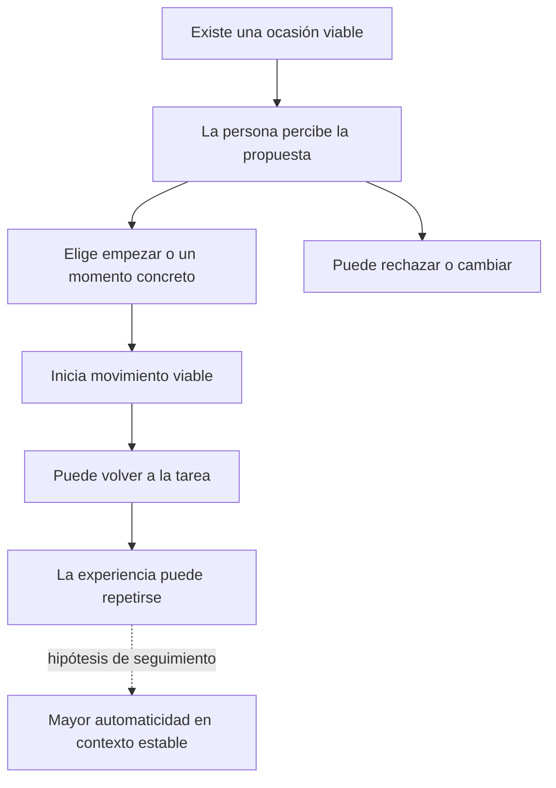

# De comprender el problema a una app y un pitch defendibles

**Actualización 23-10:** consultar [auditoría científica](AUDITORIA_CIENTIFICA_MVP_2026-10-23.md) y [ficha vigente](FICHA_MVP_PROPUESTA_2026-10-23.md). La transición es el objetivo; los procesos que podrían facilitarla siguen como hipótesis. El contraste genérico/concreto es secundario y condicional, sin imponer una barrera única. Se corrigió abajo la lectura general del resumen de Iqbal/Bailey tras recuperar el original.

Fecha: 22-10-2026. Proyecto: nikucode. Estado: síntesis científica aplicada y propuesta provisional de MVP; sin código competitivo ni eficacia propia demostrada.

## Alcance de producto confirmado por Alex

Alex indica mantener la propuesta **para computador y celular**, orientada a personas cuyo estudio o trabajo implica periodos prolongados con poco movimiento. Esta es una decisión de alcance del equipo; no una conclusión de superioridad multiplataforma demostrada científicamente.

Distribución candidata de responsabilidades: el computador permite acceder a la intervención en el contexto de la tarea; el celular puede permitir usarla en otros contextos o consultar una guía cuando resulte útil. Ambos deben permitir un recorrido comprensible por sí mismos. No exigir cambiar de dispositivo para completar una pausa ni sostener el celular durante el movimiento. El contenido y los estados de interacción pueden ser coherentes con disposición adaptada a cada pantalla.

**Por resolver:** sistemas operativos reales, canal de entrega, funcionalidades mínimas en cada destino y si es necesario compartir estado. Dos destinos no implican automáticamente sincronización, cuenta o backend. Si se usa más de uno a la vez, comprobar duplicación de avisos y definir una política explícita; no prometer coordinación entre dispositivos antes de implementarla y probarla.

«Poco movimiento durante estudio/trabajo» describe el contexto elegido. No asumir que todo reposo es indeseable ni confundir tiempo de pantalla, estar sentado e inactividad física. El descanso necesario y la posibilidad de rechazar siguen formando parte del diseño.

## 1. Pregunta que guía la decisión

Alex comunica que el jurado priorizará comprender el problema, entender la solución y responder: **«¿con cuál de estas soluciones sí cambiaría esta persona?»**. Es una orientación transmitida por el equipo; no una nueva verificación de ponderaciones oficiales.

La respuesta defendible tiene cinco partes: **qué hace hoy la persona, qué le impide hacer otra cosa, qué cambia la intervención, qué resultado se observaría y por qué podría no funcionar**. Una función sin conexión con esa cadena no fortalece por sí sola la solución.

**Recomendación:** explorar una app que facilite comenzar una pausa física viable y volver a la tarea con poco trabajo adicional. Primer núcleo candidato: una propuesta concreta y modificable, posibilidad de actuar/posponer/rechazar, guía breve y cierre. El control del momento importa como hipótesis; el marcador de reanudación y el juego se prueban por separado si aparece la barrera que justificaría su coste.

La recomendación no significa que el paquete completo esté validado ni que una app sea superior a cualquier alternativa. Es una decisión de diseño condicionada al caso y al tiempo, sin usar los agregados de Leppe-Zamora en cuarentena.

## 2. El problema que realmente propusieron

La síntesis de la postulación [referencia histórica/técnica no incluida; consultar el índice y límites de procedencia] describe periodos largos de estudio/proyectos en computador, pausas que llegan tras dolor, sueño o necesidades externas, y descanso que puede continuar en otra pantalla. Ya se intentaron rutinas, registros y recordatorios que pasaron a sentirse como obligaciones incumplidas.

Eso permite una afirmación importante: **en algunos episodios la persona advierte que necesita moverse, pero continúa**. «Le falta recordar» no explica todo; «le falta motivación» tampoco está demostrado. No convertir el relato del equipo en prevalencia de estudiantes ni asumir diagnósticos, pereza o falta de información.

### Conducta inicial propuesta, pendiente de acordar

En un bloque individual de estudio o trabajo, **cuando exista posibilidad real de interrumpir**, suspender brevemente la interacción con la tarea e iniciar un movimiento elegido y viable. Su duración y contenido se definen para el prototipo, sin presentar una cifra de segundos como dosis científica universal.

Movimiento sentado, levantarse, caminar, descanso visual y reducción del tiempo sedentario son resultados distintos. Si elegimos movimiento sentado por viabilidad, el pitch debe decirlo sin prometer automáticamente menos tiempo sentado ni efectos equivalentes a caminar.

**Caso de uso sintético:** una persona está preparando un informe, tiene un paso incompleto y puede interrumpir brevemente. A veces ignora el tiempo; otras, pospone aun notándolo. No añadimos temor a perder el hilo como hecho si la persona no lo ha descrito. Este escenario representa una situación posible, no una entrevista ni un usuario validado.

**Fuera del alcance inicial:** reuniones que no puede abandonar, falta de permiso/cobertura, ausencia de una acción físicamente viable y cualquier necesidad de tratamiento. Esas condiciones pueden requerir soluciones ambientales u organizativas; insistir desde el teléfono no las resuelve.

## 3. Método y alcance de lectura

Se recuperó la postulación y la auditoría previa, especialmente resultados nulos, automaticidad, oportunidad y denominadores. Se contrastaron fuentes primarias pertinentes al elegir funciones: COM-B, iniciación frente a ejecución, elección de estrategias, planificación y pausas de universitarios. Se añadieron fuentes de autores/instituciones sobre complejidad visual y momento de interrupción.

Es una revisión selectiva, no sistemática nueva ni valoración GRADE. Donde solo hubo resumen accesible se declara. No se recuperaron nuevamente todos los suplementos ni se recalcularon efectos. No se suman estudios incluidos en revisiones como replicaciones independientes.

## 4. Evidencia que cambia decisiones

| Fuente y alcance de acceso | Resultado pertinente | Decisión y límite |
|---|---|---|
| **Michie, van Stralen y West (2011), COM-B/BCW.** Artículo primario abierto consultado, formulación y discusión. [Texto](https://link.springer.com/article/10.1186/1748-5908-6-42). | Propone analizar capacidad, oportunidad y motivación, incluyendo factores físicos/sociales y procesos automáticos/reflexivos. | Usarlo para no reducir el problema a avisos. Es un marco de diseño; clasificar una barrera no acredita que exista ni demuestra que la app funcione. |
| **Phillips y Gardner (2016), N=123, un mes.** Manuscrito aceptado consultado, método, resultados y discusión. [PDF institucional](https://kclpure.kcl.ac.uk/ws/files/38120175/Phillips_Gardner_in_press_Health_Psych_.pdf). | La fuerza del hábito de iniciar ejercicio predijo su frecuencia en los análisis multivariados; el hábito de ejecutar la secuencia no aportó lo mismo. | Priorizar cómo se empieza, además de la calidad de la guía. Estudio prospectivo con autorreportes sobre ejercicio: no prueba causalmente nuestro flujo ni hábitos de pausa. |
| **Teuber et al. (2022), N=57 analizados, diez días.** Texto completo consultado, método y discusión. [Artículo](https://www.frontiersin.org/journals/sports-and-active-living/articles/10.3389/fspor.2022.1024996/full). | Mensajes motivacionales diarios con acceso a vídeos no produjeron un efecto significativo entre grupos en participación diaria en pausas. Los mensajes se valoraron favorablemente. | Agrado y cambio conductual se separan. No basta «recordatorio bonito». Muestra pequeña, selección por encuestas respondidas, contexto de pandemia y control con acceso a vídeos/encuestas; tampoco demuestra que toda señal falle. |
| **Hiemstra et al. (2024), N=148, cuatro semanas.** Resumen primario y resumen en lenguaje sencillo consultados; editorial/PDF no accesibles en la apertura. [Registro primario](https://pubmed.ncbi.nlm.nih.gov/37584487/). | Dos variantes HAPA: elegir estrategias frente a recibirlas asignadas. Sin diferencias entre grupos para frecuencia de pausa/tiempo sentado; mayores cambios de duración, tiempo de pie y movimiento en «No Choice». Medición activPAL. | Proponer algo claro y permitir modificarlo es una candidata frente a exigir configurar todo. El ensayo no aisló número de botones ni derecho a rechazar; no respalda quitar autonomía. Ambos grupos activos impiden atribuir sus cambios pre-post a la intervención frente a no intervención. |
| **Silva et al. (2018), planificación, 13 ensayos incluidos.** Texto completo consultado, síntesis y discusión. [PLOS One](https://journals.plos.org/plosone/article?id=10.1371/journal.pone.0206294). | Efecto global sobre actividad física pequeño y no significativo: 0,15 (IC95% −0,01–0,31). Subgrupo con refuerzo: 0,25 (0,05–0,45). | Explorar un vínculo sencillo entre situación y acción, sin presentar «si-entonces» como garantía. Son resultados de actividad física y estudios heterogéneos; el subgrupo no demuestra por sí solo el efecto causal de añadir refuerzo ni valida intervalos de nuestra app. |
| **Singh et al. (2024), revisión de hábitos.** Auditoría local previa y resumen editorial indexado recuperados; reintentos de acceso completo bloqueados. [DOI](https://doi.org/10.3390/healthcare12232488), [auditoría local](investigacion/AUDITORIA_INTEGRAL_EVIDENCIA_Y_COHERENCIA.md). | La revisión reúne 20 estudios/2.601 participantes; solo cuatro examinan tiempo hasta automaticidad. Gran variación; el agregado de fuerza de hábito es pre-post. | No prometer hábito en 21, 30 o 66 días. Repetir mientras hay recordatorios, mantener después y actuar automáticamente son pruebas diferentes. No adoptar el agregado pre-post como efecto frente a control. |
| **Iqbal y Bailey (2008), gestión de notificaciones.** Original recuperado y contrastado el 23-10, estudio 2, pp. 5–9. [PDF](https://interruptions.net/literature/Iqbal-CHI08.pdf). | Resultados mixtos y dependientes de tarea/contenido; no se observó una mejora general de reanudación por política. La formulación previa procedía de un resumen y era demasiado general. | Antecedente indirecto para explorar momento; no demuestra que posponer mejore retorno ni que aumente pausas físicas. |
| **Baughan et al. (2020), N=165.** Resumen y bibliografía en sitio de autora consultados; acceso al PDF desde Wildlab falló. [Sitio de autora](https://amandabaughan.com/publications/), [DOI](https://doi.org/10.1145/3313831.3376849). | Mayor complejidad web perjudicó búsqueda y recuerdo; las preferencias modificaron el grado de afectación. | Conservar etiquetas y jerarquía clara, reducir competencia visual. Es evidencia de búsqueda web; no determina paleta, cantidad exacta de botones ni comportamiento fuera de pantalla. |

### Evidencia anterior que se conserva, sin inflarla

- **HeartSteps:** la auditoría local distingue el resultado promedio primario impreciso/no significativo del secundario favorable para sugerencias de caminar y su atenuación. No demuestra que personalizar supere a un aviso fijo, ni más actividad neta, ni menos sedentarismo. [Auditoría y referencias](investigacion/AUDITORIA_INTEGRAL_EVIDENCIA_Y_COHERENCIA.md).
- **Marcador de retorno:** antecedentes cognitivos indirectos; las fuentes más cercanas aún tenían límites de acceso y extrapolación. No prometer que «resuelve perder el hilo» ni que aumenta pausas.
- **Gamificación:** resultados en actividad física de otros contextos y estudios de experiencia no validan nuestra capa lúdica. El micro-exergame más cercano compara variantes de juego, no el mismo movimiento con/sin juego.
- **Autonomía:** se conserva la literatura previa de autodeterminación como orientación indirecta. No derivar de ella que cualquier menú de elecciones mejora el resultado ni que una opción «opcional» sea gratuita en carga.

## 5. Diagnóstico de diseño: barrera → mecanismo → función

Las filas siguientes son hipótesis a discriminar. No elegir todas a la vez por aparecer en la literatura.

| Situación que podría ocurrir | Qué tendría que cambiar | Función candidata | Qué debilitaría la decisión |
|---|---|---|---|
| No advierte una oportunidad | La oportunidad se vuelve perceptible | Señal elegida/configurada por la persona, en el canal donde pueda percibirla | Ya notaba la necesidad; no percibe el aviso; lo desactiva por carga |
| Lo nota pero interrumpir resulta costoso | Encuentra un momento acotado para salir de la tarea | Hacer ahora o posponer con un retorno explícito; sin detección automática prometida | Posponer se vuelve una cadena indefinida; aumenta administración |
| Quiere pausar pero no sabe qué hacer | Una acción se vuelve concreta y viable | Una propuesta, con cambiar/modificar disponible | La propuesta no se entiende o no puede realizarse |
| La propuesta exige demasiado | Disminuye la exigencia de la acción, conservando su propósito | Alternativa de menor demanda o detener/rechazar | Lo que queda no cumple la conducta que decimos evaluar |
| La preocupación específica es retomar | Se reduce incertidumbre de reanudación | Marcador opcional de próximo paso | Redundante con archivos abiertos; escribir cuesta más que el beneficio |
| Una pausa viable se siente poco atractiva | Mejora experiencia sin desplazar la acción | Juego/ilustración como variante independiente | Más pantalla, preparación o fricción; no mejora inicio/repetición |
| Falta permiso, espacio o posibilidad real | Cambia el entorno o el acuerdo de trabajo | Canal organizativo/ambiental; reconocer límites de la app | Una función digital se presenta falsamente como solución a esa restricción |

No asumir que los rechazos revelan el estado interno: «no ahora» puede significar urgencia, falta de oportunidad, movimiento inviable o simple preferencia. La adaptación inicial debe apoyarse en elecciones explícitas y reversibles, no diagnosticar motivos.

## 6. Propuesta de MVP para explorar

**Promesa candidata:** «Te ayuda a convertir un momento posible en una pausa de movimiento que puedas hacer y después volver a lo tuyo». Es una promesa de diseño por evaluar, sin afirmar prevención de dolor.

### A. Configuración mínima

Explicar qué hace la app y permitir probarla. Elegir solo lo que cambie la propuesta inicial: una modalidad viable y, si hay avisos, cómo/cuándo quiere recibirlos. Evitar encuesta de salud, catálogo inicial, cuenta o metas diarias si no son necesarios. No fijar un horario de «sedentarismo peligroso» sin medición ni afirmar que sabemos cuánto tiempo lleva sentado.

### B. Una propuesta concreta

Mostrar qué se hará, duración orientativa del prototipo y forma de cambiarlo. Acción principal «Empezar»; posponer y rechazar claramente disponibles. «Cambiar propuesta» debe encontrarse sin un menú complejo. No obligar a recorrer cuatro pantallas de personalización antes de moverse.

La propuesta elegida debe ser comprensible y ajustable. El contenido físico requiere selección responsable aparte; este informe no prescribe una rutina ni interpreta condiciones médicas individuales.

### C. Control del momento sin promesas falsas

Si se elige posponer, ofrecer una alternativa sencilla y explícita, por ejemplo un nuevo aviso tras un intervalo elegido. Si se ofrece «al terminar este paso», explicar cómo se reconoce: la persona lo marca o existe un evento técnico específico comprobado. Un botón que solo programa cinco minutos no detecta el final de la tarea.

No prometer que la app identifica concentración, cansancio, disposición o postura. Respetar el rechazo sin escalar avisos, bloquear trabajo o exigir justificarlo. Si el aviso desaparece no registrarlo automáticamente como rechazo.

### D. Guía y retorno

Una instrucción breve o secuencia pequeña, con alternativa textual a cualquier imagen/vídeo. Detener y cambiar disponibles. No exigir mirar continuamente el teléfono, ni sostenerlo si la acción puede hacerse sin él. Al cerrar la guía, volver con claridad y sin celebración larga obligatoria.

Si se incorpora el marcador como experimento, que esté fuera del recorrido obligatorio y disponible al volver. No exigir escribir una nota en cada pausa. Si se incorpora juego, mantener un camino equivalente sin juego para compararlo; no sumar cámara y detección corporal solo para que la demo parezca más avanzada.

### E. Registro honesto

La app puede registrar lo que realmente sabe: aviso programado, intento de entrega, clic, comienzo/final del temporizador y respuesta opcional. «Lo hice» es autorreporte; un cierre automático no equivale a movimiento. Para la demo, los datos son ficticios y se identifican como tales.

**Conservar inicialmente:** propuesta viable, cambiar, empezar/posponer/rechazar, guía accesible, detener, retorno y preferencias mínimas. **Componentes que deben ganarse su lugar:** marcador, juego, contenido educativo, historial, notificaciones adaptativas o progreso. IA, backend o sensores no tienen necesidad demostrada para esta primera pregunta.

## 7. Estructura visual al servicio del cambio

El [informe de interfaz](INVESTIGACION_ESTETICA_ESTRUCTURA_ACCESIBILIDAD_2026-10-22.md) mantiene la estética cálida y sobria como candidata. Su propósito es que se distinga qué ocurre y qué se puede hacer, con legibilidad, blancos táctiles amplios y salida visible.

La evidencia local de competidores añade restricciones observables: no tapar innecesariamente la tarea ni impedir continuar escribiendo; no etiquetar como movimiento una reproducción terminada. No se trata de afirmar que nuestra alternativa ya supera a Stretchly o Wakeout.

**Decisión de canal actualizada:** se mantienen computador y celular como destinos por decisión de Alex. Definir qué recorrido resuelve cada uno y cómo puede completarse sin cambiar de dispositivo. Si no existe un canal de señal viable, la entrada voluntaria demuestra la guía, pero no resuelve automáticamente olvido/iniciación. Los sistemas operativos, la implementación nativa/web y la necesidad de sincronización siguen pendientes; este informe no compromete una arquitectura.

## 8. Modelo de cambio y sus puntos débiles

Cada flecha es una hipótesis. Percibir no implica aceptar; aceptar no implica moverse; completar una vez no implica repetir; repetir no implica automaticidad. La app tampoco garantiza por sí sola oportunidad física/social.

Para cada enlace hay una explicación rival: novedad, demostrador que ayuda, necesidad de complacer al equipo, pausa que iba a ocurrir de todos modos, acción sustituida por otra o personas especialmente motivadas. Mostrar una demo exitosa no elimina esas alternativas.

## 9. Qué comprobar ahora y qué dejar al seguimiento

### Durante la hackatón: funcionamiento y comprensión

Usar un escenario ficticio y comprobar que la propuesta se entiende, se puede cambiar, posponer, rechazar y detener, y que el retorno conserva un estado claro. El guion puede representar «no tengo oportunidad ahora» y «esta propuesta no me sirve»; no mostrar solo el camino de aceptación.

Si alguien evalúa el artefacto, distinguir comentarios sobre la interfaz de hábitos/salud personales. Mantener datos ficticios dentro de la solución. Ninguna prueba breve se presenta como cambio de hábito o eficacia clínica. Las tecnologías asistivas y el funcionamiento técnico se verifican en la implementación real, no en un dibujo.

### Primera comparación después de fijar barrera

No convertir el MVP entero en un supuesto experimento causal de una función. Elegir **una** de estas preguntas:

- **Inicio concreto:** misma señal, contexto y opciones; una variante invita genéricamente y otra especifica la acción. Evalúa el aporte de concretar.
- **Marcador:** misma acción y señal; con/sin oferta de marcador opcional. Incluir en el análisis también a quienes no lo usan: su oferta ya puede añadir carga.
- **Momento:** misma propuesta; entrega inmediata frente a política de postergación definida. Distinguir menor interrupción de mayor demora o menor número de oportunidades.
- **Juego:** mismo movimiento, duración y guía básica, con/sin capa lúdica. Evaluar experiencia e inicio por separado.

**Criterios previos propios:** revisar cualquier barrera que impida comprender, rechazar, adaptar o detener. Conservar un componente si hay indicios de que resuelve su fricción objetivo sin un coste que lo anule. Resultados mixtos permanecen inconclusos; no imponer un «4 de 5» como umbral científico de eficacia.

### Seguimiento posterior para la pregunta conductual

Fuera de la demo, con un protocolo y consentimiento apropiados, medir oportunidades y movimiento durante periodos comparables y registrar pausas naturales. Un diseño con comparación aleatorizada de oportunidades o bloques podría estimar el efecto próximo; un antes/después solo deja más explicaciones rivales.

**Resultado principal candidato:** inicios de una pausa de movimiento definida dentro de una ventana preespecificada, por oportunidades elegibles asignadas. Definir elegibilidad antes de ver la respuesta y tratar desconocidos como desconocidos. Informar además oportunidades totales, avisos, desactivaciones, demora, finalización declarada/observada y carga percibida. Menos avisos tras rechazos puede elevar artificialmente la tasa condicional: reportar también alcance de la política.

La calidad de medición debe ser proporcional: sin sensor validado, llamarlo autorreporte; no introducir vigilancia invasiva para producir una cifra. No tratar varias ocasiones de una persona como personas independientes. No asignar aquí tamaño muestral o duración «suficientes» sin resultado, variabilidad y diseño definidos.

Para evaluar hábito se necesita además seguimiento de automaticidad y mantenimiento, separando uso con apoyo de comportamiento cuando ese apoyo cambia o cesa. Las rachas de apertura no miden ese proceso.

## 10. Qué debe responder el pitch

Un pitch persuasivo y defendible puede seguir esta secuencia —distribución orientativa, no criterio oficial—:

1. **Persona y episodio:** qué está haciendo, qué ocurre antes de que llegue a pausar y qué intentos no encajaron. Usar el relato de postulación sin agregar prevalencias o historias no recogidas.
2. **Barrera elegida:** distinguir el desconocimiento del coste de empezar, el momento y la viabilidad. Explicar qué se deja fuera.
3. **Mecanismo:** qué reduce o habilita cada pieza de la app. Dos o tres antecedentes bastan; no recitar toda la bibliografía.
4. **Demo:** mostrar una pausa aceptada y una propuesta que se modifica o rechaza. Que se vea el retorno y el control real.
5. **Evidencia y siguiente prueba:** qué funciona técnicamente, qué se observó, qué sigue siendo hipótesis y cómo se podría refutar.

### Núcleo narrativo provisional

> Nuestro caso no empieza con alguien que desconoce que necesita una pausa. En el relato del equipo, a veces esa necesidad ya se nota, pero se sigue trabajando; además, los recordatorios y registros anteriores se han sentido como otra obligación. Por eso exploramos una app que haga concreto y viable el comienzo: una propuesta breve, fácil de cambiar, con control para hacerla, posponerla o rechazarla y un regreso claro a la tarea. La demo mostrará ese recorrido. La investigación informa las decisiones, pero todavía no demuestra que nuestra app cambie el hábito. Lo que queremos comprobar después es si facilita más inicios de movimiento en ocasiones comparables sin aumentar la carga.

Adaptar los tiempos verbales al estado real: decir «construimos» o «comprobamos» solo cuando existan implementación y evidencia. Este texto no afirma que ya se haya seleccionado formalmente la propuesta.

### Preguntas difíciles que conviene poder contestar

| Pregunta | Respuesta que debería sostener el equipo |
|---|---|
| ¿Por qué cambiaría si ya ignoró alarmas? | No lo sabemos todavía. La hipótesis adicional es concretar una acción viable y facilitar el momento; se debe comparar con la alarma simple. |
| ¿Por qué no usar Wakeout o Stretchly? | Ya resuelven partes del recorrido. Debemos mostrar ajuste a una fricción concreta del caso, no inventar novedad ni superioridad. |
| ¿Por qué una app y por qué ese dispositivo? | Porque el canal elegido hace viable la intervención en ese episodio; si añade otra pantalla sin resolver una barrera, revisar el canal. |
| ¿Cómo saben que se movió? | Distinguir registros de software, autorreporte y observación. La demo no verifica hábito ni salud. |
| ¿Qué ocurre si no puede pausar? | Puede rechazar sin castigo; reconocer que puede faltar una solución de entorno u organización. |
| ¿Y si deja de usarla? | Investigar si hubo carga, falta de utilidad o ya no necesita apoyo; desinstalar no equivale siempre a fracaso conductual, ni retener equivale a beneficio. |
| ¿Por qué no añadir mascota o IA? | Son herramientas posibles si responden a una necesidad; no hay evidencia de que sean ingredientes necesarios del primer mecanismo. |

## 11. Decisión recomendada y condición para cambiarla

Avanzar con la **hipótesis de inicio viable**, conservando el marcador y el juego como variantes independientes. Antes de cerrar pantallas y stack, definir la acción, el canal real y el momento que la persona puede reconocer. La evidencia no decide por ustedes qué barrera domina: esa selección debe ser trazable al caso, no al componente que resulta más vistoso.

Si predominan falta de oportunidad o condiciones del entorno, revisar el alcance de la app. Si una invitación simple funciona igual de bien en la evaluación pertinente, retirar complejidad. Si el marcador o el juego añaden un beneficio observable con carga aceptable, justificar su incorporación entonces.

**Criterio del proyecto:** que el jurado pueda entender por qué esta intervención podría cambiar una conducta concreta y qué parte de esa explicación ya está respaldada. La credibilidad no requiere presentar incertidumbre como certeza.
